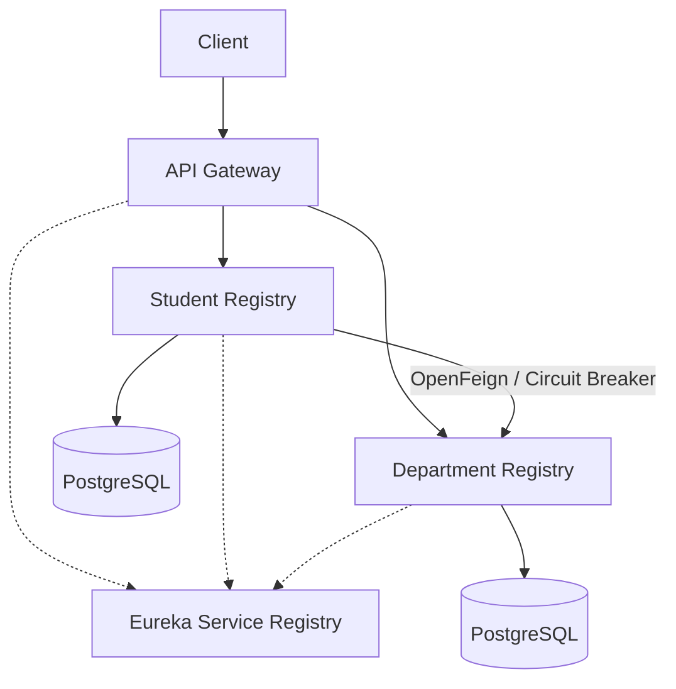

# Java Spring Boot Microservices

## 📌 Project Overview

A microservices-based Student and Department Management System 
developed using Java, Spring Boot and Spring Cloud.

This project demonstrates distributed service architecture, 
service discovery, centralized API routing, inter-service 
communication and fault tolerance.

## 🛠️ Technologies Used

| Technology | Purpose |
|------------|---------|
| Java | Backend development |
| Spring Boot | Microservices development |
| Spring Cloud Gateway | API routing |
| Netflix Eureka | Service registration and discovery |
| Spring Cloud OpenFeign | Inter-service communication |
| Circuit Breaker | Fault tolerance and resilience |
| PostgreSQL | Relational database |
| Maven | Build and dependency management |
| Git & GitHub | Version control |

## 📂 Project Structure

```text
java-spring-boot-microservices/
├── api-gateway/
├── department-registry/
├── service-registry/
├── student-registry/
└── README.md
```

## 🏗️ Microservices Architecture



## 🚀 Microservices

### 1. API Gateway

- Centralized entry point for client requests.
- Routes requests to appropriate microservices.
- Integrates with service discovery.

### 2. Service Registry

- Implements Netflix Eureka Server.
- Manages microservice registration and discovery.
- Enables dynamic service identification.

### 3. Student Registry

- Manages student information.
- Provides RESTful APIs.
- Communicates with Department Registry using OpenFeign.
- Uses PostgreSQL for data persistence.

### 4. Department Registry

- Manages department information.
- Provides RESTful APIs.
- Uses PostgreSQL for data persistence.

## ✨ Key Features

- Microservices Architecture
- RESTful API Development
- Centralized API Gateway
- Dynamic Service Discovery
- Service-to-Service Communication
- Circuit Breaker Pattern
- Fault Tolerance
- Database Integration
- Independent Service Configuration

## ⚙️ Getting Started

### Prerequisites

- Java
- Maven
- PostgreSQL
- Spring Tool Suite or IntelliJ IDEA

### Clone the Repository

```bash
git clone https://github.com/Indrabalan/java-spring-boot-microservices.git
```

### Start the Applications

Start the services individually in the following order:

1. Service Registry
2. Department Registry
3. Student Registry
4. API Gateway

Configure PostgreSQL connection properties in the respective
application configuration files before starting the services.

## 👨‍💻 Author

**Indrabalan Ramadoss**

Software Engineer | Java | Spring Boot | Microservices

- [GitHub](https://github.com/Indrabalan)
- [LinkedIn](https://www.linkedin.com/in/indrabalan-ramadoss/)
